# Self-Service Cloud Platform

> WorldSkills Cloud Computing 프로젝트 트랙 **D. Platform Engineering**

사용자가 AWS 서비스를 고르는 대신 **앱의 요구사항**(앱 형태, 트래픽, 데이터, 멈춤 허용도, 응답 속도, 공개 범위, 예산)을 입력합니다. 그러면 플랫폼이 다음을 수행합니다.

1. **규칙 기반 엔진**으로 Architecture를 고르고, 선택 이유와 제외 이유를 함께 제시합니다.
2. 예상 비용과 적용할 보안 기준을 보여준 뒤 **승인을 받습니다**.
3. **Terraform**으로 실제 AWS 환경을 만듭니다.
4. **PLAN / STATE / HTTP 3계층 검증**으로 READY / DEGRADED / FAILED를 판정합니다.
5. 같은 환경에 **새 버전을 다시 배포**하거나 이전 버전으로 되돌립니다(인프라는 그대로, terraform 재실행 없음).
6. 환경을 삭제하거나, 만료 기한(TTL)이 지나면 자동으로 정리합니다.

설계 기준 문서(Source of Truth):

| 문서 | 내용 |
|---|---|
| [docs/project-decisions.md](docs/project-decisions.md) | 확정된 모든 결정 (D-xx) |
| [docs/recommendation-engine.md](docs/recommendation-engine.md) | 추천 규칙과 근거, 시나리오 24개 |
| [docs/security-baseline.md](docs/security-baseline.md) | 모든 환경에 강제되는 보안 기준 (SB-xx) |
| [docs/production-ready.md](docs/production-ready.md) | production-ready 판정 기준 (PR-xx) |

현재 생성할 수 있는 Blueprint는 **Static(S3 + CloudFront)**, **Serverless(컨테이너 이미지 → Lambda + Lambda Web Adapter → HTTP API, DB 없음)**, **Container(컨테이너 이미지 → ECS Fargate ← 공유 internal ALB ← CloudFront VPC origin, DB 없음)**입니다. 엔진은 데이터 계층까지 추천하지만, 해당 환경은 아직 만들 수 없다고 표시됩니다.

## Architecture



| 구성 | 상태 |
|---|---|
| Control Plane | Implemented in Terraform · AWS Apply Pending |
| Static Blueprint | Implemented in Code · AWS E2E Pending |
| Serverless Blueprint (DB 없음) | AWS E2E Complete (DEV) |
| Container Blueprint (DB 없음) | Implemented in Code · AWS E2E Pending |

### Architecture Details

- [Control Plane Architecture](docs/architecture/exports/02-control-plane.svg) — 플랫폼 자체의 AWS 구성
- [Provisioning & Validation Flow](docs/architecture/exports/03-provisioning-flow.svg) — 요구사항 → 추천 → Guard → 승인 → PLAN / STATE / HTTP 검증
- [Blueprint Architecture](docs/architecture/exports/04-blueprints.svg) — 사용자에게 생성되는 환경 (Data Plane)

편집 가능한 원본은 [docs/architecture/](docs/architecture/)의 `.drawio` 파일입니다. 이전 버전은 `docs/architecture/archive/`에 보관했습니다.

## 구조

```
platform_core/        추천 엔진·단가·보안 기준·validator (순수 Python, AWS 의존 최소)
  engine/             model → gate → enumerate → filter → rank → budget → policy
  validation/         plan.py(PLAN) state.py(STATE) http.py(HTTP) artifact.py result.py(판정)
control_plane/        API Lambda, Step Functions worker Lambda, DynamoDB store
runner/               CodeBuild에서 실행하는 Terraform runner (plan → PLAN 검증 → apply → 파일 배포)
infra/modules/        s3-site-origin, edge-cloudfront, observability-cloudfront
infra/blueprints/     static (환경마다 state 1개)
infra/platform/       control plane + 계정 baseline (log/state/upload bucket, CloudTrail, Budget)
web/                  Web UI (build 없는 Vanilla JS, Static Blueprint와 같은 module로 배포)
tests/                엔진 시나리오, validator negative test, API 흐름
scripts/              build_bundles.py, e2e_static.py
```

## 로컬 실행과 테스트 (AWS 불필요)

```bash
python -m pip install -r requirements-dev.txt
python -m playwright install chromium        # UI 테스트용 브라우저

python scripts/local_dev.py                  # → http://localhost:8000
python -m pytest -q                          # 전체 테스트 (UI 포함, 약 3분)
python -m ruff check .
python scripts/scan_secrets.py
```

Node.js는 필요하지 않습니다. Web UI는 build 단계가 없는 HTML/CSS/ES module입니다.

### 로컬 개발 서버의 AWS 경계

`scripts/local_dev.py`는 **실제 Web UI와 실제 API Lambda handler**를 같은 프로세스에서 실행합니다. 라우팅, 추천 엔진, admission, artifact 검사, DynamoDB 기록 로직이 모두 실제 코드입니다. AWS와 맞닿는 부분만 아래처럼 로컬 대체물로 바꾸며, 화면 상단에 "로컬 시뮬레이션" 배너가 항상 표시됩니다.

| 실제 배포 | 로컬 개발 서버 |
|---|---|
| DynamoDB / S3 / Step Functions | moto (메모리, 종료 시 사라짐) |
| Cognito 로그인 | `/local/auth`가 서명 없는 개발용 토큰 발급 |
| S3 presigned POST 업로드 | 같은 origin의 `/local/upload/<env>` |
| CodeBuild `terraform apply` / `destroy` | 실행하지 않음. 시뮬레이터가 상태만 진행 |
| publisher Lambda(재배포: S3 sync + CDN invalidation) | 실행하지 않음. 로컬 사이트가 새 revision 파일을 제공 |
| PLAN 검사 | `--plan` 옵션을 주면 **실제 오프라인 terraform plan + PLAN validator** 실행 |
| STATE / HTTP 검사 | "로컬 미실행"으로 표시. 로컬에 띄운 사이트에 대한 실제 GET(PR-ALL-02)과 배포 버전 확인(PR-S-03)만 실행 |

화면 상태를 확인하려면 환경 이름에 `fail`을 넣으면 보안 실패가, `degraded`를 넣으면 접속 실패가 **[로컬 시뮬레이션]** 표시와 함께 주입됩니다.

### 테스트 구성

| 위치 | 내용 |
|---|---|
| `tests/engine` | 시나리오 24개, 결정성, 고정비 정당화, 탈락 이유 |
| `tests/validation` | 오프라인 terraform plan(DEV/PROD/IP 제한)으로 PLAN 검사, 위반 구성 13종 negative, STATE(Stubber)·HTTP(실제 로컬 서버) negative, 보안 기준·검사 항목 coverage, 쉬운 말 제목 coverage |
| `tests/control_plane` | 승인 흐름(quota, 예산, 관리자 승인, secret 탐지, 재시도) — moto |
| `tests/ui` | **실제 Chromium**으로 전체 사용자 흐름, 오류·빈 상태, 검증 오류, 모바일 390px/1024px, 키보드 조작, axe-core 접근성(serious/critical 0건). 스크린샷은 `build/screenshots/` |
| `tests/test_repo_hygiene.py` | secret 없음, deployer policy 범위, 예시 파일에 자격 증명 없음, 로컬 stub이 배포 번들에 들어가지 않음 |

## 배포

### 1. 전용 IAM 사용자 (root 사용 금지, D-131)

1. AWS Console → IAM → Policies → **Create policy** → JSON에 [infra/iam/deployer-policy.json](infra/iam/deployer-policy.json)을 붙여 넣고 `sscp-deployer-policy`로 저장합니다. 플랫폼이 쓰는 서비스, 서울·us-east-1 리전, `sscp-*` role/policy로 범위를 한정하고, IAM 사용자·access key·NAT 생성은 거부합니다.
2. IAM → Users → **Create user** `sscp-deployer` → 위 policy를 붙입니다. 실제 환경은 이 권한이 아니라 boundary가 걸린 runner role(`sscp-runner`)이 만듭니다.
3. Security credentials → **Create access key**(CLI) → `aws configure --profile sscp`. 키는 `~/.aws/credentials`에만 두고, repository나 `.env`에는 두지 않습니다.
4. root 사용자의 access key는 비활성화하거나 삭제합니다(root → Security credentials).

```bash
export AWS_PROFILE=sscp AWS_REGION=ap-northeast-2
aws sts get-caller-identity   # Arn이 :user/sscp-deployer 인지 확인
aws cloudtrail describe-trails --query 'trailList[].Name'   # 이미 trail이 있으면 아래에 지정
```

### 2. 설정과 사전 점검

```bash
cp .env.example .env && source .env                                   # AWS_PROFILE=sscp, 리전
cp infra/platform/terraform.tfvars.example infra/platform/terraform.tfvars   # admin_email 입력
python scripts/build_bundles.py
python scripts/preflight.py      # 읽기 전용: root 거부, 리전, 기존 CloudTrail·Budget, bundle, tfvars, secret
```

AWS profile 이름을 넣는 곳은 **`AWS_PROFILE` 환경 변수 한 곳**입니다. Terraform, boto3 스크립트, AWS CLI가 모두 이 값을 읽습니다.

### 3. 플랫폼 배포

```bash
terraform -chdir=infra/platform init
terraform -chdir=infra/platform plan -out=platform.plan   # 생성될 리소스 확인
terraform -chdir=infra/platform apply platform.plan
```

출력되는 `ui_url`로 접속합니다. 관리자 계정의 임시 비밀번호는 `admin_email`로 발송되고, 첫 로그인 때 새 비밀번호를 정합니다. 다른 사용자는 Cognito에서 관리자가 추가합니다(`allow_admin_create_user_only`).

### 4. E2E (실제 AWS)

```bash
python scripts/e2e_static.py --negative
```

생성 → READY → 보안 위반 주입(bucket policy의 TLS Deny 제거) → FAILED와 접속 차단 확인 → 삭제 → 리소스 소멸 확인 순서로 실행하고, 소요 시간을 `build/e2e-report.json`에 기록합니다.

## 비용과 안전장치

- 플랫폼 자체의 고정비는 거의 없습니다. Lambda, API Gateway, Step Functions, DynamoDB(on-demand), CloudFront, CodeBuild(분 단위 과금)만 씁니다. **NAT Gateway·ALB·RDS는 만들지 않습니다.**
- 승인 전에 예상 비용(대표값~상한값)을 보여줍니다. 상한값이 예산을 넘으면 승인을 막고 완화안을 제시합니다.
- 사용자당 DEV 2개·PROD 1개, 플랫폼 전체 예상비 월 $30, AWS Budgets 월 $30(80% 알림)을 적용합니다.
- DEV 환경은 7일 뒤 자동 삭제됩니다(연장 가능). FAILED 환경도 TTL로 정리되며, 삭제에 실패하면 최대 3회까지 자동으로 다시 시도합니다.
- 모든 리소스에 `project=sscp`, `env-id`, `owner`, `tier`, `blueprint` tag를 붙입니다.

## 플랫폼 제거

`terraform destroy`만 실행하면 중간에 멈춥니다. 데이터 보호를 위해 일부러 막아 둔 리소스가 있기 때문입니다.

| 리소스 | destroy를 막는 설정 | 먼저 할 일 |
|---|---|---|
| DynamoDB `sscp-environments` | `deletion_protection_enabled = true` | 삭제 보호 해제 |
| Cognito `sscp-users` | `deletion_protection = "ACTIVE"` | 삭제 보호 해제 |
| S3 `sscp-logs-<account>`, `sscp-uploads-<account>` | `force_destroy = false` | 객체 비우기 |
| S3 `sscp-state-<account>` | `force_destroy = false` + **versioning** | 현재 객체뿐 아니라 **이전 version과 delete marker까지** 삭제 |

플랫폼 자신의 Terraform state는 로컬 `infra/platform/terraform.tfstate`에 있습니다. `sscp-state-*` 버킷에는 사용자 환경의 state(`envs/`)와 runner 번들만 들어 있으므로, 이 버킷을 비워도 플랫폼 destroy에는 영향이 없습니다.

1. **모든 사용자 환경을 UI에서 삭제**하고, 목록에서 모두 `DELETED`가 될 때까지 기다립니다. 환경은 각자 별도 state로 관리되므로, 이 단계를 건너뛰면 CloudFront와 S3가 계정에 남습니다.
2. **삭제 보호를 해제**합니다.

   ```bash
   aws dynamodb update-table --table-name sscp-environments --no-deletion-protection-enabled
   POOL_ID=$(terraform -chdir=infra/platform output -raw user_pool_id)
   aws cognito-idp update-user-pool --user-pool-id "$POOL_ID" --deletion-protection INACTIVE
   ```

   `update-user-pool`은 지정하지 않은 설정을 기본값으로 되돌립니다. 곧 삭제할 pool이므로 문제는 없지만, 삭제 직전에만 실행하세요.
3. **버킷 3개를 비웁니다.** state 버킷은 versioning이 켜져 있어서 `aws s3 rm --recursive`로는 이전 version과 delete marker가 남습니다. 그래서 version 단위로 지웁니다.

   ```bash
   ACCOUNT=$(aws sts get-caller-identity --query Account --output text)
   python - "$ACCOUNT" <<'PY'
   import sys, boto3
   s3 = boto3.resource("s3")
   for name in ("logs", "uploads", "state"):
       b = s3.Bucket(f"sscp-{name}-{sys.argv[1]}")
       b.object_versions.delete()   # 현재 객체 + 이전 version + delete marker
       print("emptied", b.name)
   PY
   ```

4. **destroy를 실행합니다.**

   ```bash
   terraform -chdir=infra/platform destroy
   ```

   CloudTrail과 CloudFront 로그는 몇 분 늦게 도착할 수 있습니다. 그래서 `BucketNotEmpty`로 멈추면 3단계(logs 버킷)를 한 번 더 실행한 뒤 destroy를 다시 실행하세요. destroy는 여러 번 실행해도 안전합니다.
5. **Terraform 밖에서 생긴 것을 정리합니다.** Step Functions가 처음 CodeBuild를 실행할 때 EventBridge 규칙 `StepFunctionsGetEventForCodeBuildStartBuildRule`을 직접 만듭니다. 비용은 없지만, 깨끗이 지우려면 아래 명령을 실행합니다.

   ```bash
   aws events remove-targets --rule StepFunctionsGetEventForCodeBuildStartBuildRule \
     --ids $(aws events list-targets-by-rule --rule StepFunctionsGetEventForCodeBuildStartBuildRule --query 'Targets[].Id' --output text)
   aws events delete-rule --name StepFunctionsGetEventForCodeBuildStartBuildRule
   ```
