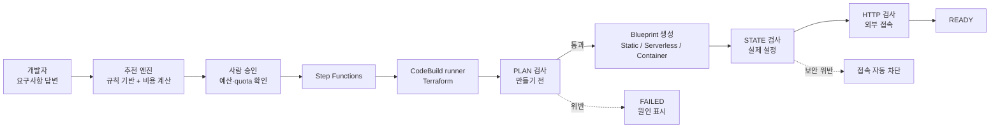

# [제안서] 요구사항 기반 Self-Service Cloud Platform

2026-10-09 · 〔이름〕

CFP 4장 요건에 맞춘 1차 초안입니다. 트랙 D의 예시 주제 "10분 안에 production-ready 환경"을 출발점으로 삼았습니다. 수치는 실제 AWS(계정 1개, ap-northeast-2)에서 측정한 값이고, 아직 측정하지 않은 값은 그렇게 표시했습니다.

## 1. 제목 / 트랙

| 항목 | 내용 |
|---|---|
| 제목 | 앱 요구사항에 답하면 AWS 환경을 추천·생성·검증·회수하는 Self-Service Cloud Platform |
| 트랙 | D. Platform Engineering (실행 경로에 AI Agent 없음, AI coding tool은 개발에 사용) |
| Project Lead | 〔선수 번호 / 이름〕 |
| Reviewer | 〔선수 번호〕, 〔선수 번호〕 |

## 2. 문제 정의

AWS에 앱 하나를 올리려면 개발자가 compute 방식, 네트워크, IAM, 로그, 보안 헤더, 비용 구조를 모두 직접 정해야 합니다. 같은 "웹 서비스"라도 정적 사이트는 S3+CloudFront, 짧고 불규칙한 API는 Lambda, 연결을 오래 유지하는 서버는 Container가 맞는데, 이 판단을 사람마다 따로 하면 환경마다 구조와 보안 수준이 달라지고 쓰지 않는 고정비나 과도한 권한이 남습니다. 이 프로젝트를 만들면서도 같은 일이 실제로 일어났습니다. Terraform이 로컬에서 모두 통과한 뒤에도 실제 AWS에서만 드러나는 권한 누락과 한도 초과로 배포가 여러 번 멈췄고, `terraform apply`가 성공해도 그 환경이 안전하다는 보장은 없었습니다. 개발자가 AWS 서비스 대신 앱의 요구사항(트래픽, 요청 시간, 실시간 연결, 데이터, 멈춤 허용, 공개 범위)에 답하면, 플랫폼이 구성을 고르고 승인 후 만들고, 만든 결과를 자동으로 검증하고, 다 쓰면 남김없이 회수하게 하는 것이 이 프로젝트가 풀려는 문제입니다.

## 3. 목표와 최종 지표

요구사항에 답한 개발자가 AWS 서비스를 하나도 고르지 않고 검증된 환경을 10분 안에 받되, 만들어지는 모든 환경이 같은 보안·비용 기준을 자동으로 만족하고, 삭제 후에는 아무것도 남지 않게 하는 것이 목표입니다.

**정량 지표**

| 지표 | 현재 (실측) | 목표 | 측정 방법 |
|---|---|---|---|
| 승인 → READY 시간 (DEV) | Static 3분 58초, Serverless 1분 43초, Container 첫 생성 17분 40초(공유 인프라 12분 42초 포함, READY 판정 전) | 모든 Blueprint 10분 이내. Container의 공유 인프라 최초 생성은 20분 이내 | 환경 기록의 승인 시각과 READY 판정 시각 차이. Blueprint별로 3회 이상 측정 |
| 보안 기준 위반 차단 | READY 환경 FAIL 0 (Static, Serverless). 로컬 위반 주입 테스트는 검사마다 있음 | READY 환경 FAIL 0, 위반 주입 시나리오 10종 100% 차단 | PLAN·STATE·HTTP 검사 결과. 실제 AWS에서 일부러 잘못된 설정을 넣는 Negative E2E |
| 삭제 후 남는 리소스 | Static·Serverless·Container 모두 0 (Container는 공유 인프라 21개까지 함께 삭제 확인) | 0 | 삭제 후 read-only 조회(Terraform state, IAM role, ECR, log group, VPC origin, CloudTrail 생성 이벤트) |

**정성 지표**

- 다른 선수 2명이 직접 환경을 만들어 보고 남긴 피드백: 질문이 이해하기 쉬운지, 실패했을 때 메시지만 보고 다음 행동을 정할 수 있는지
- 실제 AWS에서 겪은 장애마다 원인·수정·재발 방지 테스트가 남은 postmortem과 ADR

**Scope**

- **Must**: 요구사항 질문과 결정적(deterministic) 추천 엔진, DB 없는 Static·Serverless·Container DEV 환경의 생성·검증·삭제, 승인 전 비용 표시와 예산 상한, PLAN·STATE·HTTP 검증, 실패 원인 표시
- **Nice-to-have**: Serverless + DynamoDB, Serverless 재배포·롤백, Container autoscaling, PROD 환경 E2E, 자연어 요구사항을 질문 답변으로 바꿔 주는 보조 agent
- **Out of scope**: EKS, RDS, multi-region, blue/green 배포, custom domain, 여러 AWS 계정

## 4. 접근 방법

개발자는 AWS 서비스가 아니라 앱의 특징에 답합니다. 추천 엔진은 같은 입력에 항상 같은 결과를 내는 규칙 기반이고, 사람이 승인해야만 실제 AWS가 바뀝니다. "만들었다"와 "쓸 수 있다"를 구분하기 위해, READY는 만들기 전 plan 검사, 만든 뒤 실제 설정 검사, 외부 접속 검사를 모두 통과했을 때만 줍니다.

Blueprint별 구조는 다음과 같습니다. Container는 다른 두 개보다 무거워서, 환경마다 ALB를 만들지 않고 여러 환경이 공유하는 구조로 정했습니다.

| Blueprint | 구조 | 이렇게 정한 이유 |
|---|---|---|
| Static | 비공개 S3 + CloudFront(OAC) | 고정비 0, S3 직접 접근 차단 |
| Serverless | 사용자 container image + Lambda Web Adapter → Lambda → HTTP API | 요청이 없으면 비용 0. 원본 image는 그대로 두고 adapter를 얹은 image를 플랫폼이 따로 만듦 |
| Container | CloudFront → VPC origin → 공유 내부 ALB → Fargate(공인 IP, NAT 없음) | 실시간 연결·긴 요청·메모리 상태가 필요한 앱용. ALB는 인터넷에 노출하지 않고, NAT Gateway 고정비를 피함 |

| 결정 | 선택 | 이유 |
|---|---|---|
| 추천 방식 | 규칙 기반 엔진 (LLM 사용 안 함) | 같은 입력에 같은 결과, 추천 이유를 코드로 설명할 수 있음 |
| 실행 | Step Functions + CodeBuild에서 Terraform, 환경별 state | 고정비 0, 실행 이력이 남음, 실패 단계가 분명함 |
| 권한 | runner 권한에 상한(permissions boundary), 환경 role에도 별도 상한, `sscp-env-*` 이름으로 범위 제한 | 플랫폼이 강한 권한을 가져도 다른 리소스나 플랫폼 자신을 건드리지 못하게 |
| 공유 인프라 | 첫 Container 환경이 만들고 마지막 환경이 삭제 | Container 환경이 없을 때 ALB 고정비 0 |
| 보안 위반 시 | 판정 즉시 접속 차단(CloudFront 비활성, Lambda 동시성 0) | 위반한 환경이 잠깐이라도 열려 있지 않게 |

**AI Agent 활용과 사전 학습 적용**

- **실행 경로에는 agent를 넣지 않습니다.** AI Capabilities and Limitations에서 배운 대로 LLM은 같은 질문에도 답이 달라질 수 있으므로, 추천과 승인 판단은 규칙 기반 로직이 하고 실제 AWS 변경은 반드시 사람이 승인합니다.
- **개발에는 AI coding tool(Claude Code)을 씁니다.** Claude Code 101의 방식대로 repository에 project context 파일을 두고, AI에게는 read-only 조회만 맡기며, `terraform apply`와 삭제는 사람이 plan을 확인한 뒤 실행합니다. 이 프로젝트의 모든 platform apply는 이 방식으로 했습니다.
- **Building Effective Human-Agent Teams**: AI가 plan을 검토하고, 사람이 승인하는 역할 분담을 그대로 운영합니다. 실제로 AI가 놓친 권한 누락을 사람이 실행 결과로 발견한 사례들을 4장 결과와 postmortem에 기록합니다.
- **Introduction to MCP**: Linear MCP를 연결해 실제 AWS에서 발견한 문제를 Issue로 만들고 engineering log와 연결합니다.
- **Nice-to-have agent**: "채팅 서버인데 사용자가 100명쯤"처럼 자연어로 쓴 설명을 질문 답변 초안으로 바꾸는 보조 agent입니다. 답변은 사람이 확인한 뒤에만 추천 엔진에 들어가며, agent 유무에 따라 입력 완료 시간과 잘못 고른 답의 수를 비교합니다.

## 5. 예상 비용

플랫폼 자체는 사용량 과금 서비스(Lambda, API Gateway, DynamoDB, Step Functions, CodeBuild)로만 만들어서 고정비가 거의 없습니다. 환경 비용은 플랫폼의 단가표(2026-10-04 기준 근사값)로 계산했고, 제출 전에 AWS Pricing Calculator로 다시 확인합니다.

| 항목 | 월 예상 비용 (USD) |
|---|---|
| Control Plane (Cognito, API Gateway, Lambda, DynamoDB, Step Functions, S3, CloudFront, CloudTrail 1개) | 〔Pricing Calculator 확인〕 사용량 기반, 고정비 거의 없음 |
| CodeBuild runner | 환경 1회 생성·삭제마다 분 단위 과금 〔확인〕 |
| Static DEV 환경 1개 | 1 미만 |
| Serverless DEV 환경 1개 | 1 미만 |
| Container DEV 환경 1개 | 최대 12 (Fargate Spot 1개 + 공유 ALB를 4개 환경이 나눈다고 계산). 혼자 쓰면 약 23.5 |
| 실제 AWS E2E 테스트 | 별도 예산 10 |

**비용 안전장치** (모두 구현됨)

- AWS Budgets 월 $30: 실제 비용 80%, 예측 비용 100%에서 메일 알림
- 플랫폼 전체 상한 $30: 새 환경의 최대 비용을 더하면 넘을 때 승인 단계에서 차단(사용자가 우회할 수 없음)
- 사용자당 환경 수 제한: DEV 2개, PROD 1개. DEV 환경은 7일 뒤 자동 삭제
- NAT Gateway, 고정 IP(EIP), EC2 instance는 만들기 전 검사에서 차단
- Bedrock은 쓰지 않습니다. Nice-to-have agent를 붙이면 CFP 8장의 네 가지 한도를 먼저 설정합니다

## 6. 예상 리스크

가장 큰 리스크는 로컬 테스트를 다 통과해도 실제 AWS에서만 드러나는 문제입니다. 이번 구현에서 이미 7번 겪었기 때문에, 새 Blueprint는 반드시 DEV 환경 하나로 실제 AWS에서 끝까지 확인한 뒤에 완료로 봅니다.

| 리스크 | 영향 | 대응 |
|---|---|---|
| 실제 AWS에서만 드러나는 IAM 누락·한도 (실제 발생: `apigateway:TagResource`, log delivery 7개, `ecs:ListServiceDeployments`, `ecs:ListTasks`, inline 정책 10,240자 한도, Linux용 provider checksum 누락) | 생성·검증 실패 | 실패마다 회귀 테스트로 고정. 검증 코드의 AWS 호출마다 필요한 권한을 AWS 공식 레퍼런스 기준 "권한 지도"로 테스트 |
| 검증기 오탐 (실제 발생: 공유 route table을 위반으로 판정) | 정상 환경이 차단됨 | 테스트용 가짜 응답을 실제 AWS 응답 형태로 맞추고, 실제 E2E 응답을 테스트 데이터로 보관 |
| Container 고정비 (ALB, 항상 실행되는 task) | 방치하면 비용 누적 | 공유 ALB는 마지막 환경과 함께 삭제, 예산 상한, DEV TTL 7일 |
| 공유 인프라 생성·삭제가 오래 걸림 (VPC origin 9분, 삭제 7분) | 첫 Container 생성 20분 가까이 | 진행 단계 메시지 표시, CodeBuild 90분 timeout, 두 번째 환경부터 공유 인프라 재사용 |
| AI가 만든 코드·권한의 오류 | 잘못된 설정이 배포됨 | 사람이 plan 확인 후 apply, 설명할 수 없는 코드는 merge하지 않음 |

## 7. 학습 계획

ECS Fargate와 CloudFront VPC origin, IAM 권한 레퍼런스는 이번 프로젝트에서 처음 깊게 다루는 영역이라, Container 완료 전까지 아래 학습을 병행하고 engineering log에 `학습` tag로 남깁니다.

| 기술·서비스 | 현재 수준 | 필요한 이유 | 공부 방법 |
|---|---|---|---|
| ECS Fargate, ALB, CloudFront VPC origin | 첫 E2E에서 생성까지 성공 | Container Blueprint 완성 | 공식 문서, 실제 E2E 응답 분석, 두 번째 환경으로 공유 인프라 재사용 확인 |
| IAM Service Authorization Reference | 실패를 통해 읽기 시작 | action마다 필요한 resource type이 달라 누락이 반복됨 | 검증 코드의 AWS 호출별 권한 지도 작성, IAM Access Analyzer policy 검증 |
| Terraform provider·state·lock | 실제 장애 경험 있음 | Windows 개발과 Linux CodeBuild 실행 환경 차이 | 여러 플랫폼 lock 파일, saved plan과 state serial 동작 실습 |
| AWS 비용 모델 | 근사 단가표로 계산 | 추천 순위와 예산 상한의 정확도 | Price List API로 단가 갱신, 실제 청구서와 비교 |
| Claude Academy 필수 강좌 4개 | 〔수강 상태 확인〕 | CFP 필수, AI 사용 원칙 | 〔수강 후 적용 내용 기록〕 |

## AI 사용 내역

| 항목 | AI를 쓴 방식 | 받아들인 것 / 버린 것과 이유 |
|---|---|---|
| 2. 문제 정의 | 〔본인 초안 작성 후〕 AI에게 반론 요청 | 〔작성 후 기록〕 |
| 4. 접근 방법 | 공유 ALB와 환경별 ALB, NAT와 공인 IP 등 대안 비교를 받음 | 비용 기준으로 공유 ALB + NAT 없는 구조를 선택. 결정은 질문 방식으로 직접 확정 |
| IAM·Terraform | AI가 정책과 Terraform 초안을 작성 | 실제 AWS에서 6건이 누락돼 있었음. AI가 "불필요하다"며 지운 권한이 실제로 필요했던 사례도 있어서, 권한을 줄일 때는 공식 레퍼런스 근거를 먼저 남기는 규칙을 만듦 |
| 검증 코드 | AI가 검사 로직과 테스트를 작성 | 테스트용 가짜 응답이 실제 AWS 응답과 달라 오탐이 났음. 실제 응답 형태로 테스트를 고침 |
| 이 제안서 | GPT로 초안, Claude로 실측값 기준 재구성 | 확인되지 않은 수치는 쓰지 않고 표시만 함 |

## 참고: 초기 Linear 구성

| Milestone | 대표 Issue | 상태 |
|---|---|---|
| 1. Control Plane + Static | 요구사항 질문, 추천 엔진, 승인, Static E2E (생성 → 재배포 → 롤백 → 삭제) | 완료 |
| 2. Serverless | Lambda Web Adapter image 생성, HTTP API, Serverless E2E | 완료 |
| 3. Container | 공유 인프라, ECS Fargate, Container E2E, 두 번째 환경 재사용 확인 | 진행 중 |
| 4. Hardening | Negative E2E 10종, 검증기 오탐 방지, 로그 버킷 versioning | 예정 |
| 5. 마무리 | postmortem, engineering log, 최종 보고서, 15분 발표, 3분 demo | 예정 |
