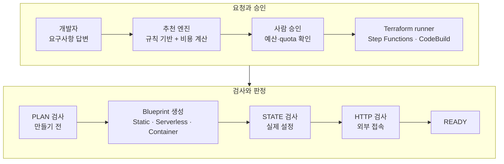

# [제안서] 요구사항 기반 Self-Service Cloud Platform

2026-10-09 · 이진서

CFP 4장 요건에 맞춘 제안서입니다. 트랙 D의 예시 주제 "10분 안에 production-ready 환경"을 출발점으로 삼았습니다. 이미 일부를 구현했기 때문에 수치마다 **실측**(실제 AWS, ap-northeast-2), **예상**, **목표**를 구분해 적었습니다.

## 1. 제목 / 트랙

| 항목 | 내용 |
|---|---|
| 제목 | 앱 요구사항에 답하면 AWS 환경을 추천·생성·검증·회수하는 Self-Service Cloud Platform |
| 트랙 | D. Platform Engineering (실행 경로에 AI Agent 없음) |
| Project Lead | 이진서 |
| Reviewer | 선수 2번, 3번 |

## 2. 문제 정의

AWS에 앱 하나를 올리려면 개발자가 compute 방식, 네트워크, IAM, 로그, 보안 헤더, 비용 구조를 모두 직접 정해야 합니다. 같은 "웹 서비스"라도 정적 사이트는 S3+CloudFront, 짧고 불규칙한 API는 Lambda, 연결을 오래 유지하는 서버는 Container가 맞는데, 이 판단을 사람마다 따로 하면 환경마다 구조와 보안 수준이 달라지고 쓰지 않는 고정비나 과도한 권한이 남습니다. 더 큰 문제는 "만들었다"와 "안전하게 쓸 수 있다"가 다르다는 점입니다. 이 플랫폼을 만드는 동안에도 Terraform이 로컬에서 모두 통과한 뒤 실제 AWS에서만 드러나는 권한 누락·한도 초과·검증 오류로 배포가 7번 멈췄습니다. 이 프로젝트의 핵심은 Terraform 템플릿을 대신 실행해 주는 것이 아니라, **개발자가 AWS 서비스를 고르지 않아도 요구사항에서 구성을 정하고, 적용 전 plan과 적용 후 실제 설정·외부 접속을 따로 검증해 기준을 만족한 환경에만 READY를 주고, 다 쓰면 남김없이 회수하는 것**입니다.

## 3. 목표와 최종 지표

Static·Serverless 환경과, 공유 인프라가 준비된 Container 환경은 **승인 후 10분 안에 READY**가 되는 것이 목표입니다. Container를 처음 만들 때만 공유 VPC origin 생성 시간 때문에 **20분 안**을 목표로 따로 둡니다. 모든 환경은 같은 보안·비용 기준을 자동으로 만족하고, 삭제 후에는 아무것도 남지 않아야 합니다.

| 지표 | 현재 | 목표 | 측정 방법 |
|---|---|---|---|
| 승인 → READY (DEV) | Static 3분 58초, Serverless 1분 43초 **(실측)**. Container는 리소스 완성까지 17분 40초 **(실측, 공유 인프라 최초 생성 12분 42초 포함)**, 이후 환경 약 5분 **(예상)** | Static·Serverless·warm Container 10분 이내, cold Container 20분 이내 | 환경 기록의 승인·READY 시각 차이, Blueprint별 3회 |
| 보안 기준 위반 차단 | READY 환경 FAIL 0 (Static, Serverless **실측**). Container는 자동 검사 45개 통과, 검증기 오탐 1건 수정 중 | READY 환경 FAIL 0, 실제 AWS 위반 주입 10종 100% 차단 | PLAN·STATE·HTTP 검사 결과, Negative E2E |
| 삭제 후 남는 리소스 | 0 **(실측)**. Static·Serverless는 READY 후 삭제, Container는 실패 후 삭제 2회에서 공유 인프라 21개까지 함께 삭제 | 0 | 삭제 후 read-only 조회(state, IAM, ECR, log group, VPC origin, CloudTrail) |

**정성 지표**: 다른 선수 2명이 직접 환경을 만들어 보고 ① 수동 구성 대비 걸린 시간 ② 추천 이유를 이해했는지 ③ 실패 메시지만 보고 다음 행동을 정할 수 있었는지를 답한 결과, 그리고 실제 장애마다 원인·수정·재발 방지 테스트를 남긴 postmortem과 ADR.

**Scope**

- **Must**: 요구사항 질문과 결정적(deterministic) 추천 엔진, DB 없는 Static·Serverless·Container DEV의 생성·검증·삭제, 승인 전 비용 표시와 예산 상한, PLAN·STATE·HTTP 검증, 실패 원인 표시
- **Nice-to-have**: Serverless + DynamoDB, Serverless 재배포·롤백, Container autoscaling, PROD E2E, 자연어 입력 보조 agent
- **Out of scope**: EKS, RDS, multi-region, blue/green 배포, custom domain, 여러 AWS 계정

## 4. 접근 방법

개발자는 앱의 특징(트래픽, 가장 긴 요청 시간, 실시간 연결, 메모리 상태, 데이터, 멈춤 허용, 공개 범위)에 답합니다. 추천 엔진은 같은 입력에 항상 같은 결과를 내는 규칙 기반이고, 사람이 승인해야만 실제 AWS가 바뀝니다.

세 검사 중 하나라도 기준을 어기면 READY가 되지 않고 FAILED와 실패 단계·원인이 기록됩니다. 보안 위반이면 차단 조치를 바로 시작합니다(Serverless는 동시성 0으로 즉시, CloudFront를 쓰는 Static·Container는 배포 비활성화가 전파되는 수 분 안에).

| 구분 | 선택 | 이유 |
|---|---|---|
| Static | 비공개 S3 + CloudFront(OAC) | 고정비 0, S3 직접 접근 차단 |
| Serverless | 빌드: 사용자 image에 Lambda Web Adapter를 얹은 image를 따로 만들어 ECR에 저장 / 요청: Client → HTTP API → Lambda | 요청이 없으면 비용 0, 원본 image는 바꾸지 않음 |
| Container | Client → CloudFront → VPC origin → 공유 내부 ALB → Fargate(공인 IP, NAT 없음) | 실시간 연결·긴 요청·메모리 상태가 필요한 앱용. ALB는 인터넷에 노출하지 않고 NAT 고정비를 피함 |
| 추천 방식 | 규칙 기반 엔진 (LLM 사용 안 함) | 같은 입력에 같은 결과, 추천 이유를 코드로 설명할 수 있음 |
| 권한 | runner와 환경 role 모두 permissions boundary, `sscp-env-*` 이름으로 범위 제한 | 강한 권한을 가진 runner도 다른 리소스나 플랫폼 자신을 건드리지 못하게 |
| 공유 인프라 | 첫 Container 환경이 만들고 마지막 환경이 삭제 | Container 환경이 없을 때 ALB 고정비 0 |

**AI Agent 활용과 사전 학습 적용 계획** (필수 강좌 4개를 수강한 뒤 아래 계획을 확정합니다)

- **실행 경로에는 agent를 넣지 않습니다.** AI Capabilities and Limitations의 관점대로 LLM은 같은 질문에도 답이 달라질 수 있으므로, 추천과 승인 판단은 규칙 기반 로직이 하고 AWS 변경은 사람이 승인합니다.
- **개발에는 AI coding tool을 쓰되 권한을 나눕니다**(Claude Code 101, Human-Agent Teams). AI에게는 AWS read-only 조회와 plan 검토만 맡기고, `terraform apply`와 삭제는 사람이 plan을 확인한 뒤 실행합니다. 지금까지의 platform 변경은 모두 이 방식으로 했습니다.
- **선택 기능 agent**: 자연어 설명을 질문 답변 초안으로 바꾸는 입력 보조만 맡고, 사람이 확인한 답만 엔진에 들어갑니다. agent 유무에 따라 입력 시간과 잘못 고른 답의 수를 비교합니다. Linear MCP로 장애를 Issue와 engineering log에 연결합니다(Introduction to MCP).

## 5. 예상 비용

플랫폼 자체는 사용량 과금 서비스로만 만들어 고정비가 거의 없습니다. 환경 비용은 플랫폼 단가표(2026-10-04 기준 근사값)로 계산했고 제출 전 AWS Pricing Calculator로 다시 확인합니다.

| 항목 | 월 예상 비용 (USD) |
|---|---|
| Control Plane (Cognito, API Gateway, Lambda, DynamoDB, Step Functions, S3, CloudFront, CloudTrail) + CodeBuild | 약 1–3 (사용량 기반, 추정) |
| Static DEV 1개 / Serverless DEV 1개 | 각 1 미만 |
| Container DEV 1개의 직접비 (Fargate Spot 0.25 vCPU·0.5 GB + 공인 IPv4) | 약 7 |
| Container 공유 인프라 (내부 ALB, 시간 요금 + 최소 LCU) | 약 17, Container 환경이 1개 이상 있을 때만 |
| 추천 화면의 Container 1개 최대 비용 (직접비 + ALB를 4개 환경이 나눈 몫) | 최대 12 |
| Container가 1개뿐일 때 실제 총비용 (직접비 + ALB 전액) | 약 23.5 |
| 실제 AWS E2E 테스트 | 별도 예산 10 |

**비용 안전장치** (구현 완료): AWS Budgets 월 $30(실제 80%·예측 100% 알림), 플랫폼 전체 상한 $30(넘으면 승인 단계에서 차단, 사용자가 우회 불가), 사용자당 DEV 2개·PROD 1개, DEV 7일 뒤 자동 삭제(1시간마다 확인), NAT Gateway·EIP·EC2 instance는 만들기 전 검사에서 차단. 입력 보조 agent를 붙이면 CFP 8장의 Bedrock 한도 네 가지를 먼저 설정합니다.

## 6. 예상 리스크

가장 큰 리스크는 로컬 테스트를 다 통과해도 실제 AWS에서만 드러나는 문제입니다. 구현 중 7번 겪었고, 매번 **실패 → 원인 → 최소 수정 → 회귀 테스트 → 다음 E2E** 순서로 고정했습니다. 그래서 새 Blueprint는 실제 AWS에서 생성부터 삭제까지 확인한 뒤에만 완료로 봅니다.

| 리스크 | 영향 | 대응 |
|---|---|---|
| 실제 AWS에서만 드러나는 권한 누락·한도 (실제: API Gateway 태그 권한, log delivery 권한, ECS 배포 추적 권한, `ecs:ListTasks`의 resource type, IAM inline 정책 10,240자, Linux용 provider checksum) | 생성·검증 실패 | 실패마다 회귀 테스트. 검증 코드의 AWS 호출마다 필요한 권한을 공식 레퍼런스 기준 "권한 지도"로 테스트, 정책 크기도 테스트 |
| 검증기 오탐 (실제: 공유 route table을 위반으로 판정) | 정상 환경 차단 | 테스트용 가짜 응답을 실제 AWS 응답 형태로 맞추고 E2E 응답을 테스트 데이터로 보관 |
| Container 고정비와 실패한 환경의 방치 (실제: 실패한 환경이 11.5시간 남아 약 $0.5) | 비용 누적 | 공유 ALB는 마지막 환경과 함께 삭제, 예산 상한, DEV TTL. 실패한 DEV 환경 자동 정지를 추가 목표로 둠 |
| AI가 만든 코드·권한의 오류 | 잘못된 설정 배포 | 사람이 plan 확인 후 apply, 설명할 수 없는 코드는 merge하지 않음 |

## 7. 학습 계획

| 기술·서비스 | 현재 수준 | 필요한 이유 | 공부 방법 |
|---|---|---|---|
| ECS Fargate, ALB, CloudFront VPC origin | 생성과 HTTPS 응답까지 성공 | Container Blueprint 완성 | 공식 문서, E2E 응답 분석, 두 번째 환경으로 공유 인프라 재사용 확인 |
| IAM Service Authorization Reference | 실패를 통해 읽기 시작 | action마다 필요한 resource type이 달라 누락이 반복됨 | 검증 코드의 AWS 호출별 권한 지도, IAM Access Analyzer policy 검증 |
| Terraform provider·state·lock | 실제 장애 경험 | Windows 개발과 Linux CodeBuild의 차이 | 여러 플랫폼용 lock 파일, saved plan과 state serial 실습 |
| Claude Academy 필수 강좌 4개, Bedrock·MCP | 제안서 제출 전 수강 예정 | CFP 필수, agent 적용 계획 확정 | 필수 4개(약 7시간) 수강 후 4장 확정, Claude with Amazon Bedrock 중 tool use 부분 |

**근거 관리**: 본문의 실측값은 Git repository의 Evidence Index에서 환경 ID, AWS 로그, 검사 결과, 테스트 결과(현재 자동 테스트 382개 통과)와 1:1로 추적할 수 있게 관리합니다. Milestone은 Linear에서 Control Plane+Static(완료) → Serverless(완료) → Container(진행 중) → Hardening → 마무리 순으로 관리합니다.

## AI 사용 내역

| 항목 | AI를 쓴 방식 | 받아들인 것 / 버린 것과 이유 |
|---|---|---|
| 2. 문제 정의 | GPT와 1차 초안을 쓴 뒤 Claude에게 실측 기록 기준으로 다시 검토를 받음 | "Terraform을 대신 실행해 주는 도구와 무엇이 다르냐"는 관점을 받아들여, apply 성공 뒤에도 실제 AWS에서만 드러난 실패를 근거로 "만들었다 ≠ 안전하게 쓸 수 있다"를 중심에 둠. 확인되지 않은 수치는 버림 |
| 4. 접근 방법 | 공유 ALB와 환경별 ALB, NAT와 공인 IP 등 대안 비교를 받음 | 비용 기준으로 공유 ALB + NAT 없는 구조를 선택, 결정은 대안을 질문으로 비교해 직접 확정 |
| IAM·검증 코드 | AI가 정책·검사 로직·테스트 초안을 작성 | 실제 AWS에서 권한 누락과 오탐이 나왔음. AI가 불필요하다며 지운 권한이 실제로 필요했던 사례가 있어, 권한을 줄일 때는 공식 레퍼런스 근거를 먼저 남기는 규칙을 만듦 |
