# Self-Service Cloud Platform

> WorldSkills Cloud Computing 프로젝트 트랙 · **D. Platform Engineering** · 1차 제안서 초안
> 2026-10-05 · Project Lead: 〔선수 번호 / 이름〕

---

## 1. 제목 / 트랙

| 항목 | 내용 |
|---|---|
| 제목 | **애플리케이션 요구사항만 입력하면 AWS 환경을 추천·생성·검증·회수하는 Self-Service Cloud Platform** |
| 트랙 | **D. Platform Engineering** (Runtime AI Agent 없음, AI coding tool은 개발에만 사용) |
| 핵심 사용자 | AWS 인프라에 익숙하지 않은 애플리케이션 개발자 |
| Project Lead | 〔선수 번호〕 |
| Reviewer | 〔선수 번호〕, 〔선수 번호〕 |

---

## 2. 문제 정의

AWS에 앱을 올리려면 개발자가 compute 방식, 데이터 저장소, 네트워크, 보안, 모니터링, 비용을 모두 직접 결정해야 합니다. 앱의 요구사항(트래픽, 데이터, 멈춰도 되는지)은 알아도, 그것을 어떤 AWS 서비스와 설정으로 옮겨야 하는지는 AWS에 익숙하지 않으면 판단하기 어렵습니다. 그 결과 정적 사이트에 필요 이상의 인프라를 만들거나, 반대로 비용을 줄이려다 public bucket이나 HTTP 노출 같은 보안 기준을 놓칩니다. 게다가 Terraform이 성공했다고 해서 바로 production-ready가 되는 것은 아니며, 실제 설정과 외부 접속까지 확인해야 합니다. 이 프로젝트는 개발자가 AWS 서비스 대신 **앱의 요구사항**을 입력하면, 플랫폼이 비용·보안·가용성을 고려해 구성을 고르고, 승인 후 실제로 만들고, 자동으로 검증하는 것을 목표로 합니다.

> 핵심 질문: **개발자가 AWS를 직접 설계하지 않아도, 요구사항만으로 검증된 AWS 환경을 받을 수 있는가?**

〔작성자 확인: 직접 겪었거나 본 사례 한 줄(예: 연습 중 만든 리소스가 public이었던 경험, 정적 사이트 하나 배포에 걸린 시간)을 넣으면 문제의 근거가 강해집니다.〕

---

## 3. 목표와 최종 지표

**목표**: 요구사항 입력부터 검증된 환경을 받기까지 개발자가 AWS 서비스를 하나도 고르지 않게 하되, 만들어지는 모든 환경이 같은 보안·비용 기준을 자동으로 만족하게 합니다.

### 정량 지표

| 지표 | 현재 | 목표 | 측정 방법 |
|---|---|---|---|
| **환경 생성 시간** (승인 → 검증 완료) | 수동 구성 시 〔측정 예정〕 | Static ≤ 5분, Serverless ≤ 7분, Container ≤ 12분 (RDS 포함 ≤ 20분) | 승인 시각과 READY 판정 시각의 차이를 환경 기록에서 집계. 수동 기준값은 리뷰어 2명이 같은 정적 사이트를 직접 구성한 시간으로 측정 |
| **보안 위반 탐지율** | 로컬 negative test 기준 100% | 실제 AWS에서도 준비한 위반 시나리오 **100% 탐지, 위반 환경 READY 0건** | 일부러 잘못된 plan·설정·HTTP 응답을 넣어 PLAN / STATE / HTTP 판정 확인. Security Baseline 항목마다 최소 1개 검사가 연결되었는지 자동 test로 확인 |
| **추천 정확도** | 정의한 시나리오 24개 통과 (로컬) | 대표·경계·충돌·지원 불가 시나리오에서 허용 정답 집합 포함 **100%**, 같은 입력의 결과 변화 0건 | 시나리오 test suite와 결정성 test (같은 입력 반복, 입력 순서 변경) |

보조 지표: 예산 초과 무단 생성 **0건**. 사용자 예산을 넘는 환경은 명시적 승인(`budget_override` 기록)이 있을 때만 생성되고, 플랫폼 월 상한($30)과 quota는 어떤 승인으로도 넘을 수 없습니다.

### 정성 지표

- **비전문 개발자 사용성**: AWS 경험이 적은 사용자(다른 선수 2명 이상)가 도움 없이 Static 환경을 만들고 삭제까지 마치는지 관찰하고, 막힌 지점을 기록합니다.
- **설명 가능성**: 사용자가 추천 결과를 보고 "왜 이 구성이고, 다른 후보는 왜 빠졌는지"를 자기 말로 설명할 수 있는지 리뷰어 피드백으로 평가합니다.

### Scope

- **Must**: 요구사항 입력(Custom Flow · Quick Start Template), 결정적 Recommendation Engine, Static / Serverless / Container 추천과 생성, 예상 비용·보안 기준·검사 항목 표시, PLAN / STATE / HTTP 검증, 승인·삭제·DEV TTL 자동 정리, 비용·quota·보안 guardrail
- **Nice-to-have**: Static 재배포와 rollback, 사용자 도메인 연결, 가격표 자동 갱신(Price List API), Quick Start Template 추가
- **Out of scope**: EKS, AWS Organizations 기반 multi-account, private Git 연동, 지속적인 drift 자동 복구, Runtime AI Agent 기반 Architecture 선택

---

## 4. 접근 방법

플랫폼은 **Control Plane**(플랫폼 자체)과 **Data Plane**(사용자에게 만들어 주는 환경)으로 나눕니다. 자세한 구성은 [Control Plane](../architecture/exports/02-control-plane.svg), [Provisioning & Validation Flow](../architecture/exports/03-provisioning-flow.svg), [Blueprint](../architecture/exports/04-blueprints.svg) 문서에 있습니다.

| 결정 | 선택 | 이유 |
|---|---|---|
| 입력 | AWS 서비스 대신 앱 요구사항 8개(앱 형태, 트래픽 규모·패턴, 데이터, 멈춤 허용도, 응답 속도, 공개 범위, 예산) + DEV/PROD. 목적이 분명하면 Quick Start Template | 사용자가 아는 것만 묻기. Template도 같은 Requirement Model을 만들어 **같은 엔진**을 거침 |
| 추천 | 규칙 기반 7단계 엔진 (Normalize → Gate → Enumerate → Filter → Rank → Budget → Policy) | 같은 입력에 같은 결과, 모든 선택·제외에 reason code. 필터 순서는 기능 → 보안 → 가용성 → 성능 → 비용이라, 싸다는 이유로 보안을 포기하지 않음 |
| Blueprint | Static(CloudFront + 비공개 S3), Serverless(Lambda + Web Adapter + API Gateway), Container(ECS Fargate + CloudFront VPC Origin → internal ALB) | 정적 / 간헐적 API / 상시·긴 요청이라는 세 형태를 덮는 최소 집합. EKS는 운영 부담 대비 효과가 낮아 제외 |
| Control Plane | CloudFront + S3 UI, Cognito, API Gateway + Lambda, DynamoDB, Step Functions, CodeBuild Terraform runner | 상시 실행 서버 없이 사용량 과금. Terraform은 권한 경계가 걸린 CodeBuild 안에서만 실행 |
| 검증 | PLAN(생성 전 plan JSON) → STATE(생성 후 실제 설정) → HTTP(외부 접속) → READY / DEGRADED / FAILED | 생성 성공이 곧 안전은 아니므로 세 시점으로 나눔. 보안 실패는 endpoint 차단 + FAILED |
| 비용 guard | 사용자 예산은 soft(완화안 또는 명시적 초과 승인), 플랫폼 상한·quota·보안 기준은 hard | 사용자 판단을 존중하되 계정 전체 위험은 막음 |

### AI Agent 활용과 사전 학습 적용

Architecture 선택과 생성 판단에는 **AI Agent를 쓰지 않습니다.** 결과가 매번 같아야 하고 test로 검증할 수 있어야 하기 때문입니다. 대신 AI coding tool(Claude Code)을 개발 과정에 쓰며, 사전 학습 내용을 다음처럼 적용합니다.

- **AI Capabilities and Limitations**: LLM은 같은 입력에도 답이 달라질 수 있고 틀린 답을 자신 있게 낼 수 있습니다. 그래서 비용·보안이 걸린 선택은 규칙 엔진에 맡기고, AI는 설계 대안 검토·코드 초안·리뷰에만 씁니다.
- **Claude Code 101**: repository에 project context(설계 결정 문서 D-xx, 금지 사항, region, tag 규칙)를 두고 매 작업의 전제로 씁니다.
- **Building Effective Human-Agent Teams**: AI 도구에는 배포 권한을 주지 않습니다. `terraform apply`, destroy, 첫 AWS 배포는 사람이 plan과 검토 결과를 확인한 뒤 직접 실행합니다. 플랫폼 안에서도 생성은 사용자 승인, PROD는 관리자 승인을 거칩니다.
- **Introduction to MCP**: architecture diagram은 draw.io 도구 연동으로 편집 가능한 파일로 관리합니다. Linear를 연결해 Issue를 읽고 갱신하는 것도 계획하고 있습니다.

---

## 5. 예상 비용

> 엔진 가격표(`seed-2026-10-04`, ap-northeast-2, 수동 입력 근사치)와 platform terraform plan(84개 리소스) 기준입니다. 최종 제출 전 AWS Pricing Calculator로 다시 계산합니다.

| 항목 | 월 예상 비용 (USD) | 근거 |
|---|---|---|
| Control Plane (환경 0개, 대기 상태) | **1 미만** | NAT·ALB·RDS·EC2 등 시간 과금 리소스 0개. Lambda·API Gateway·DynamoDB·Step Functions는 요청 과금, CloudTrail은 첫 관리 이벤트 trail이라 저장비만 |
| Terraform 실행 (CodeBuild) | 1회 약 0.02–0.04 | 환경 생성·삭제 때만 3–5분 실행 |
| Static 환경 1개 (저트래픽) | 1 미만 | CloudFront·S3 사용량 과금 |
| 선택 옵션 | IP 제한 시 WAF 약 6, PROD 알람 약 0.2 | 해당 입력을 고를 때만 생성 |
| Container 환경 (계획) | 공유 ALB 약 16(환경 간 분할) + Fargate task 1개 약 10 + public IPv4 약 3.7 | 고정비가 있어 엔진이 근거 코드(`FIX_*`)와 함께 필요할 때만 선택 |
| 관계형 DB (계획) | RDS t4g.micro 약 18 + 저장 | 관계형 데이터가 꼭 필요할 때만 |
| **프로젝트 전체 상한** | **30** | AWS Budgets 80%(실제) · 100%(예상) 알림 + 엔진·승인 단계의 플랫폼 상한 hard guard |

---

## 6. 예상 리스크

| 리스크 | 영향 | 대응 |
|---|---|---|
| 규칙이 잘못된 구성을 추천 | 비용 증가 또는 요구사항 미충족 | 대표·경계·충돌·지원 불가 시나리오 test, 모든 후보의 선택·제외 이유 기록, 결정성 test |
| Terraform runner·worker 권한이 계정의 다른 리소스를 건드림 | 플랫폼 자체 또는 다른 리소스 손상 | 역할별 최소 권한, runner 권한 경계(IAM·Organizations 거부), CloudFront 변경은 `env-id` 태그가 붙은 사용자 환경으로만 제한, PLAN 검사 |
| 예상 비용과 실제 청구의 차이 | 예산 판단 오류 | 비용을 대표·상한 범위로 표시하고 가격표 기준일 표기, E2E 후 실제 청구와 비교해 보정 |
| 실제 AWS에서만 드러나는 문제 (권한 누락, CloudFront 전파 시간) | 생성 시간 SLO 초과, E2E 지연 | 로컬 시뮬레이션과 실제 경로를 분리해 두고, Static 하나를 실제 AWS에서 끝까지 검증한 뒤 다음 Blueprint로 진행 |
| 질문이 비전문가에게 어려움 | 잘못된 요구사항 입력 | AWS 용어 대신 앱 사례 중심 질문, 예시 보기, Quick Start, 지원 불가 시 원인 답변으로 바로 이동 |

---

## 7. 학습 계획

〔작성자 확인: "현재 수준" 칸은 본인 기준으로 고쳐 주세요.〕

| 기술·서비스 | 현재 수준 | 필요한 이유 | 공부 방법 |
|---|---|---|---|
| Terraform plan JSON · state backend | 〔실습 경험 있음〕 | PLAN 검증, 환경별 state 분리 | 공식 문서, 위반 plan을 일부러 만들어 validator로 검사 |
| IAM 권한 경계 · 태그 기반 조건 | 〔기본 사용〕 | runner·worker가 계정 전체를 건드리지 못하게 | Service Authorization Reference, IAM policy simulator, 거부되어야 할 동작의 negative test |
| CloudFront OAC · 보안 헤더 | 〔사용 경험 있음〕 | Static Blueprint와 플랫폼 UI | 비공개 origin, S3 직접 접근 403, HSTS 실습 |
| Step Functions · CodeBuild | 〔추가 학습 필요〕 | plan → 검증 → apply workflow | 작은 환경으로 성공·실패·재시도 경로 반복 |
| Cognito · API Gateway JWT | 〔추가 학습 필요〕 | 플랫폼 인증과 관리자 승인 | 로그인 → 토큰 → authorizer 흐름 실습 |
| Lambda Web Adapter · ECS Fargate | 〔추가 학습 필요〕 | Serverless·Container Blueprint | 같은 HTTP container를 Lambda와 Fargate에서 실행 |
| Playwright · axe | 〔추가 학습 필요〕 | 실제 사용자 흐름과 접근성 회귀 방지 | 핵심 흐름 E2E와 접근성 test 작성 |

공부한 내용과 막힌 문제는 engineering log에 `학습` tag와 함께 날짜·가설·시도·결과·소요 시간으로 남깁니다.

---

## AI 사용 내역

| 항목 | AI를 쓴 방식 | 받아들인 것 / 버린 것과 이유 |
|---|---|---|
| 2. 문제 정의 | 〔본인 초안〕을 쓴 뒤 빠진 점과 반론 요청 | 〔작성자 확인: 실제로 받아들이거나 버린 반론을 적어 주세요〕 |
| 4. 접근 방법 | Architecture 대안과 trade-off 검토 | EKS 중심 플랫폼 제안은 버림(운영 부담 대비 효과 낮음). AI Agent 기반 추천도 버림(결정성·검증 불가). Static / Serverless / Container 세 Blueprint 채택 |
| IaC · 코드 | Terraform·Python 초안과 리뷰 | plan 리뷰에서 AI가 찾은 CloudFront 권한 과다 범위를 태그 조건으로 좁힘. AI와 함께 쓴 초기 설계 문서의 요청 시간 규칙(CloudFront 60초)이 틀린 것을 AWS 공식 문서로 확인해 120초로 정정 |
| 5. 예상 비용 | 비용 항목 초안 | 항목 구성은 사용, 금액은 엔진 가격표와 terraform plan으로 다시 확인, 제출 전 Pricing Calculator로 재계산 |
| 문서 · 다이어그램 | README, 다이어그램 초안 | 구현 상태(구현 / AWS 검증 대기 / 계획)를 사람이 직접 대조해 수정 |

---

## 제출 전 확인할 것

- 〔 〕 칸 채우기: 선수 번호, reviewer, 학습 계획의 현재 수준, AI 사용 내역의 실제 경험
- 수동 구성 기준 시간 측정 (정량 지표 1의 "현재" 값)
- Static 실제 AWS E2E 결과로 생성 시간 값 갱신
- AWS Pricing Calculator 결과로 5장 금액 갱신
